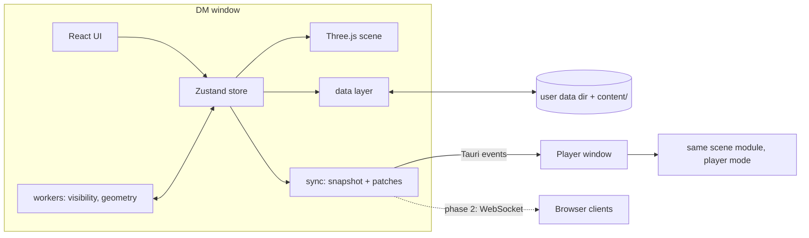

# Fogwarden — Plan

Status: **approved** · Successor of the WPF proof of concept `240722_DnD_DMTool` (left untouched).

## 1. Goal

A desktop app for a Dungeon Master running 5e encounters at the table:

- **DM view**: library of creatures, maps and area templates; encounter tracker (initiative, HP, conditions, notes, attack/dice rolls, stat blocks); 3D battle map with tokens and area markers.
- **Player view**: same battle map rendered for players with fog of war computed from what their tokens can actually see (line of sight, light, darkvision, truesight, magical darkness).
  - Phase 1: second window on a second monitor / TV.
  - Phase 2: browser on any device in the LAN (tablets, phones).
- **Map editor (priority 1)**: take a normal 2D battlemap image and turn it into a 3D scene — terrain sculpted under the image, walls/buildings traced on top of it, Blender models imported — with the 2D battlemap projected onto every surface so it still looks like the original map from above.
- Clean separation of **source**, **build output** and **data** (shipped content vs. user data).

### Non-goals (for now)
- Character sheet management / level-up for player characters (players are lightweight creature entries).
- Online multiplayer over the internet, accounts, cloud sync.
- Rules automation beyond rolls, ranges, areas and vision (no automatic spell resolution).

## 2. Stack

| Concern | Choice | Why |
|---|---|---|
| Language | TypeScript (strict) | Chosen. One language for DM view, player view and LAN browser client. |
| Shell | Tauri 2 | Small binaries, native windows (multi-window), file system + dialogs, Rust side can later host the LAN server. |
| UI | React 18 + Vite | Largest ecosystem; first-class Three.js binding. |
| 3D | Three.js via react-three-fiber + drei | Custom shaders for map projection/fog, TransformControls/gizmos for the editor, GLTFLoader for Blender models. |
| State | Zustand + Immer | Small, works across React and non-React (render loop, workers); Immer patches give undo/redo and sync deltas for free. |
| Schemas | Zod | Validate every file read from disk; versioned migrations. |
| Heavy compute | Web Workers | Visibility/fog and geometry building off the UI thread. |
| Tests | Vitest (unit); GUI smoke in the real WebView2 over its DevTools port | |
| Lint/format | ESLint + Prettier | |

Toolchain on this machine: Node 24, pnpm 10, Rust 1.95 (MSVC target), WebView2 154, VS 2022 Build Tools
(MSVC 14.44), Windows SDK 10.0.26100. TypeScript stays on 6.x until typescript-eslint supports 7.

### Dependencies
- Runtime: `react`, `react-dom`, `three`, `@react-three/fiber`, `@react-three/drei`, `three-mesh-bvh` (0.8, the
  version drei uses), `zustand`, `immer`, `zod`, `ulid`, `@tauri-apps/api`.
- Dev: `typescript`, `vite`, `@vitejs/plugin-react`, `@tauri-apps/cli`, `vitest`, `eslint`,
  `@eslint/js`, `typescript-eslint`, `eslint-plugin-react-hooks`, `globals`, `prettier`, `tsx` (runs `tools/*.ts`),
  `@types/react`, `@types/react-dom`, `@types/three`, `@types/node`.
- Rust: `tauri` (with `protocol-asset`), `tauri-build`, `serde`, `serde_json`; M6 adds `axum`, `tokio`.
- File access goes through the app's own Rust storage commands (`src-tauri/src/storage.rs`) instead of the fs/dialog
  plugins: one place enforces path containment and atomic writes, and file picking uses `<input type="file">`.
- GUI smoke tests drive the real WebView2 over its DevTools port (`WEBVIEW2_ADDITIONAL_BROWSER_ARGUMENTS=
  --remote-debugging-port=9222 pnpm app:dev`); no browser download is needed.

## 3. Repository layout — source vs. build vs. data

```
261012_DnD_DMTool/
  PLAN.md
  package.json, pnpm-lock.yaml, tsconfig*.json, vite.config.ts
  src/                     # all TypeScript source
    core/                  # pure domain logic, no DOM/Three imports (testable in node)
      model/               # zod schemas + types: creature, attack, map, encounter, marker
      rules/               # dice, modifiers, proficiency, CR/XP, area templates, vision rules
      import/              # stat block text parser (port of TextToObjectGenerator), legacy JSON importer
    data/                  # storage abstraction: library (read-only), user store, migrations
    sync/                  # DM -> player protocol (snapshot + patches), transports
    render/                # Three.js scene: terrain, structures, props, tokens, markers, fog, shaders
    editor/                # map editor tools, undo/redo commands
    ui/                    # React components: dm/, player/, editor/, shared/
    workers/               # visibility + geometry workers
    app/                   # window entry points: dm.tsx, player.tsx
  src-tauri/               # Rust shell (Tauri config, capabilities, later LAN server)
  content/                 # SHIPPED default content, versioned in git (SRD 5.1 only)
    creatures/  markers/  maps/  LICENSE-SRD.md
  tools/                   # CLI scripts: legacy import, raw stat block import, content build
  tests/                   # e2e smoke tests
  docs/
  # build output (all gitignored)
  dist/                    # vite build
  src-tauri/target/        # rust build
  artifacts/               # installers
```

**User data** never lives in the repo or next to the exe. Default location `%APPDATA%/io.github.sunyknight.fogwarden/` (Tauri `appDataDir`), overridable in settings (e.g. a Dropbox folder):

```
<data root>/
  settings.json
  library/                       # user-created/imported library entries
    creatures/<id>.json
    markers/<id>.json
    maps/<id>/map.json           # one folder per map
    maps/<id>/assets/            # battlemap image, imported .glb models, thumbnails
  campaigns/<campaign-id>/
    campaign.json
    encounters/<id>.json         # tokens, initiative, HP, markers, fog memory
```

- Every file has `{ "schema": "<type>", "version": n, ... }`; loaders run migrations up to the current version and validate with Zod.
- Stable IDs (ULID) instead of names as file names → renaming no longer deletes/duplicates files (legacy `SaveData` deleted everything not in the collection).
- Writes are atomic (write temp file, rename) and debounced; no save-on-every-property-change.
- Shipped `content/` is read-only; editing a shipped entry creates a user copy ("override").

**Copyright**: `MonsterRawData/MM` and the JSON derived from it are Monster Manual content. They are imported into the user data dir by a tool, never committed. The repo ships SRD 5.1 (CC-BY-4.0) creatures only, with attribution.

## 4. Domain model (core)

- **CreatureType** (library): name, size, type, tags, alignment distribution, AC, HP dice, speeds (walk/burrow/climb/fly/swim), ability scores, saving throw proficiencies, skills (proficiency level → computed bonus), damage resistances/immunities/vulnerabilities, condition immunities, senses (darkvision, blindsight, tremorsense, truesight, passive perception), languages, CR/XP, traits, actions (attacks with to-hit/damage dice/damage type/reach/range), legendary actions, image/token image, source/license.
- **Encounter** (campaign): map reference, combatants, initiative order + current turn + round, area markers, fog memory, DM notes.
- **Combatant**: reference to CreatureType (or inline PC), display name, side (player/ally/enemy/neutral), HP current/max/temp, initiative, conditions, position (x, y, elevation, facing), vision override, `isPlayerVisionSource`, hidden-from-players flag, notes.
- **AreaMarker**: shape (cone, cube, cylinder, line, sphere per 5e templates), size in ft, origin, direction, color, label, optional duration.
- **Map**: see section 5.

Rules in `core/rules`: dice expressions (`2d6+3`, multiple terms, advantage/disadvantage), ability modifier, proficiency by CR/level, average HP, area template → affected grid cells (5e "template covers ≥ half a square" rule), distance (5e default 5-ft diagonals, optional 5/10 variant), vision evaluation.

## 5. Map system — replacing the per-tile cuboids

### What's wrong with the PoC model
Every 5-ft tile is a box with one base height and four edge-wall heights.
- Terrain is stair-stepped; no slopes, hills, ramps or rivers.
- Walls only on tile edges, only axis-aligned; no diagonal/curved walls, no thickness/doors/windows.
- Editing means selecting tiles and typing numbers; slow and error-prone.
- Wall sides get smeared/stretched map pixels.
- Illumination and movement types stored per tile → no clean way to draw a dark room or a pond.
- Geometry, rules (LOS) and rendering are all tied to the tile grid.

### New model: independent layers over a calibrated image

The grid becomes a **measurement overlay**, not the geometry backbone.

1. **Battlemap image + calibration** — image file, pixels per square, grid offset, rotation; defines the image ↔ world transform (1 world unit = 5 ft). Calibration tool: drag the grid over the image or click two grid corners. Map may extend beyond the image (fallback ground color/texture).
2. **Terrain** — continuous heightfield at sub-square resolution (default 4×4 samples per square, configurable). Sculpting brushes: raise, lower, smooth, flatten (to sampled height), ramp (between two points), terrace/cliff, noise; brush radius/strength/falloff; height picker. Steep faces automatically get a cliff material instead of smeared pixels.
3. **Structures (vector walls)** — polylines drawn over the image, snapping to grid corners/edges/half-squares/other wall ends (snapping toggleable for curved/diagonal walls). Per wall: height, thickness, base elevation, side material, blocks movement/sight/light flags. **Openings** placed on walls: door (open/closed/locked/secret), window (blocks movement, not sight), portcullis, arrow slit. Corners auto-joined (mitered). Closed polylines can become **rooms**: floor elevation, optional ceiling/roof; roofs are visible from outside and peeled away when the camera is inside or a player token is inside.
4. **Props (Blender models)** — `.glb/.gltf` import into the map's assets folder; transform gizmo (move/rotate/scale, snap); per prop: "project battlemap onto it" vs. "use model textures", occludes sight yes/no, blocks movement yes/no, walkable surface yes/no (e.g. bridge, roof, stairs).
5. **Regions** — polygons painted/drawn on the map: light level (bright/dim/darkness/magical darkness), difficult terrain, water (swim), hazards, hidden notes. Replace per-tile illumination/marking/movement lists.
6. **Lights** — point lights with bright/dim radius in ft (torch 20/20, lantern 30/30, …), color, on/off, attachable to a token; shadows from walls/props/terrain; map ambient light level (day/dusk/night).

### Rendering
- **Map projection shader**: every surface computes its battlemap UV from world position (`uv = imageTransform * worldXZ`), so the image lands exactly as in 2D from the top camera, independent of terrain height. Surfaces whose normal is close to horizontal (wall sides, cliffs, steep model faces) blend to a side material: tileable texture (stone, brick, wood, hedge, rock) tinted with the map color sampled at the wall foot (triplanar blend by normal). Wall tops show the projected image (the drawn wall line).
- **Fog/visibility shader**: a per-encounter visibility texture (sub-square resolution) with states *unknown* (black), *remembered* (desaturated/dimmed, no tokens), *visible*; DM view shows fog as a tint only.
- Cameras: top-down orthographic (classic battlemap look) and perspective orbit; player window camera follows DM or is pushed by DM.
- Performance budget: 100×100-square map, 4× terrain resolution, a few hundred wall segments, 30 tokens at 60 fps on integrated GPU; geometry rebuilt incrementally per dirty chunk (16×16 squares) in a worker.

### Vision / fog of war (port of PoC rules, corrected)
For every player-side vision source and every visibility cell:
1. **Line of sight**: 2D ray cast against wall segments (closed doors block, windows don't) via a segment BVH, then height check against terrain heightfield and props (eye height by creature size).
2. **Light level** at the cell: max of ambient, regions and lights (lights also ray-cast against walls → real shadows).
3. **Can see** if in LOS and: bright or dim light; or darkness within darkvision range (seen as dim); or magical darkness only within truesight/blindsight range; blindsight/tremorsense ignore light within range.
4. Union over all player sources → *visible*; ever visible → *remembered*.
Runs in a worker; recomputed when tokens move, doors toggle, lights change. DM can manually reveal/hide areas.

### Editor UX
Tool palette (select, calibrate, sculpt brushes, wall, opening, room, region, light, prop, measure), properties panel for the selection, layer visibility toggles, top/perspective camera switch, full undo/redo (Immer patches), autosave, "preview as player" toggle.

## 6. Application architecture



- One store is the source of truth in the DM window; the player view receives a **filtered** state (no hidden tokens, no DM notes, no secret doors, only revealed fog) — filtering happens on the DM side, so a player client never holds secrets.
- Sync protocol: versioned messages `{snapshot}` on connect, then `{patches, seq}`; transport-agnostic interface. Phase 1 transport: Tauri events between windows. Phase 2: small Rust (axum) HTTP + WebSocket server inside the Tauri process serving the player bundle on the LAN (URL + QR code in DM UI).
- `render/` is shared by editor, DM battle view and player view; mode decides what's drawn.

## 7. Feature mapping from the proof of concept

| PoC | New |
|---|---|
| `BeeingTypeClass`, `AttackTypeClass`, enums, dice helpers | `core/model/creature.ts`, `core/rules/*` (ported, bugs fixed: skills bonus, multi-term dice) |
| `TextToObjectGenerator` (stat block parser) | `core/import/statblock.ts` (ported, unit-tested against `MonsterRawData` samples) |
| `BeeingInstanceClass`, `ActiveData` | `Combatant`, `Encounter` |
| `MapTypeClass` / `MapTileTypeClass` cuboids | layered map (section 5); legacy importer converts tile heights → heightfield, edge walls → wall segments |
| `MarkingTypeClass` / `MarkerGeneratorClass` | `AreaMarker` + `core/rules/templates.ts` + render layer |
| `PlayerMapWindow` LOS + darkvision/truesight | `workers/visibility.ts` + fog shader |
| `EditMonsterWindow`, `EditAttackWindow`, `EditMarkerWindow`, `EditMapWindow` | React editors |
| JSON next to the exe in `bin/` | user data dir + shipped `content/` |

## 8. Milestones

Each milestone ends with a runnable app and the listed acceptance checks.

| # | Milestone | Acceptance |
|---|---|---|
| M0 | **Scaffold**: Tauri 2 + Vite + React + TS, lint/format/test scripts, DM + player windows, data root resolution + settings, error boundary/logging | `pnpm tauri dev` opens DM window; button opens player window on chosen monitor; settings persisted in data root |
| M1 | **Core + data**: zod schemas, rules (dice, modifiers, templates), storage with atomic writes/migrations, stat block parser port, legacy importer CLI (creatures/maps from old `bin/.../240722_DnD_DMTool_Data`), SRD content pack | Unit tests green; importer converts all legacy creature JSON + raw MM texts into the user data dir; library lists them |
| M2 | **Map editor I (prio 1)**: create map from image, grid calibration, terrain heightfield + brushes, projection shader, cliff material, top/perspective cameras, undo/redo, autosave | Import `Forest Way 1.jpg`, calibrate, sculpt a hill and a ravine; top-down view matches the 2D image; reload restores it |
| M3 | **Map editor II**: walls with snapping, openings, rooms/roofs, regions, lights with shadows, `.glb` import + gizmo + projection option | Trace the `52x49_5_Tavern_Base` walls with doors, a dark cellar region and a torch; import a Blender building and project the map onto it |
| M4 | **Encounter (DM)**: creature library browser + editor, encounter setup, tokens on the 3D map (place/move/measure/elevation), initiative tracker, HP/conditions/notes, stat block panel, attack + dice roller, area markers | Run a full round with 4 PCs and 5 goblins, place a fireball sphere, rolls logged |
| M5 | **Player view + fog**: filtered sync, visibility worker, fog shader with memory, darkvision/truesight/magical darkness, door toggling, DM reveal/hide, camera push | Player window on 2nd monitor shows only what PC tokens see; closing a door updates fog; hidden monsters never appear |
| M6 | **LAN player view**: Rust HTTP/WebSocket server, browser client from same bundle, URL/QR, reconnect | Phone browser in the same Wi-Fi shows the player view live |
| M7 | **Packaging**: icons, NSIS installer, versioning from git, data-root migration on upgrade | Installer builds in `artifacts/`, fresh install runs, existing data root is picked up |

Order: M0 → M1 (only what M2 needs first: map schema, storage) → **M2** → M3 → rest of M1 → M4 → M5 → M6 → M7.

## 9. Verification

- `core/` and `data/` fully unit-tested in Node (rules, parser against sample stat blocks, migrations, template cell coverage, visibility on small hand-made maps).
- Render/editor: smoke in the running app over the WebView2 DevTools port (create map, sculpt, screenshot of the top
  view vs. the source image for projection correctness).
- Each milestone: manual run of its acceptance scenario in the Tauri app.

## 10. Risks / open points

- **MSVC build tools** must be installed for Tauri (Rust MSVC linker); Git's `link.exe` currently shadows it on PATH.
  Installing them is a system install → needs explicit permission.
- **Disk space**: C: has 12 GB free (96 % used). Estimated need [INFERENCE]: node_modules + pnpm store ≈ 1 GB, cargo
  registry ≈ 0.5 GB, `src-tauri/target` debug ≈ 3 GB + release ≈ 1.5 GB → ≈ 6 GB; MSVC workload, if missing, +6–8 GB.
- WebView2 WebGL performance on the target machine/TV laptop — measure in M2 with the 100×100 budget.
- Wall tracing effort per map; later option: semi-automatic wall detection from dark lines in the image.
- SRD creature source for `content/`: convert from an SRD 5.1 dataset with compatible license (to verify before M1 content step).
- Phase 2 LAN server exposes a port: bind to LAN only, random session token in URL.
- Testing the LAN view on a phone touches the local network → ask before M6 tests.

## 11. Conventions

Agent and code rules: `~/.omp/agent/RULES.md` (loaded for every session). Project-specific consequences:
- One `return` per function, no `continue`, `break` only in `switch`; error exits via `throw`.
  ESLint enforces `no-continue`; single return is checked in review.
- Max line length 120: Prettier `printWidth: 120`, ESLint `max-len` 120 (comments 80).
- Comments explain why, English only; no change history in code or docs, only in `CHANGELOG.md`.
- Errors are never swallowed: data layer throws typed errors, UI layer shows them; no catch-and-ignore.
- Commits only on request; one logical change per commit.
